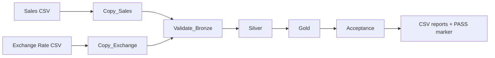
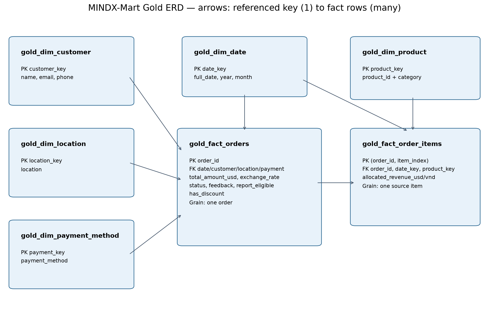

# MINDX-Mart — End-to-End Data Pipeline trên Microsoft Fabric

Hệ thống xử lý dữ liệu bán lẻ theo kiến trúc **Medallion**, sử dụng **Microsoft Fabric Data Factory**, **PySpark** và **Delta Lake**. Pipeline chuyển dữ liệu CSV thành các bảng phân tích, xử lý bất thường, cách ly bản ghi lỗi và kiểm tra kết quả trước khi xuất báo cáo.

**Tác giả:** Bùi Quang Khánh  
**Học phần:** Data Engineering — Level 3

## Mục tiêu

- Tự động hóa luồng dữ liệu từ nguồn đến các bảng báo cáo.
- Bảo toàn dữ liệu thô tại Bronze, chuẩn hóa và kiểm soát chất lượng tại Silver.
- Thiết kế mô hình dimensional với fact đơn hàng, fact dòng sản phẩm và các dimension.
- Tính doanh thu VNĐ theo tháng/danh mục và tỷ lệ sử dụng mã khuyến mãi theo địa điểm.
- Đối soát số dòng, khóa dữ liệu và doanh thu trước khi công bố kết quả.

## Công nghệ

| Thành phần | Công nghệ / vai trò |
|---|---|
| Điều phối | Microsoft Fabric Data Factory Pipeline |
| Lưu trữ | Lakehouse trên OneLake |
| Xử lý | PySpark Notebook |
| Bronze | Parquet, nén Snappy |
| Silver và Gold | Delta Tables |
| Tài liệu và đóng gói | Python, python-docx, matplotlib |

## Kiến trúc pipeline



Hai Copy Activity chạy độc lập. Các Notebook Activity chạy theo dependency **Succeeded**; `Validate_Bronze` chỉ thực thi sau khi cả hai Copy hoàn thành.

| Tầng / bước | Xử lý | Đầu ra |
|---|---|---|
| Bronze | Copy CSV sang Parquet, giữ các cột ở kiểu String | `Files/Bronze/<run_id>/sales/` và `exchange_rate/` |
| Validate_Bronze | Kiểm tra schema, số dòng và nội dung bằng `exceptAll` hai chiều | Kết quả kiểm tra dữ liệu đầu vào |
| Silver | Loại trùng, parse JSON/ngày, chuẩn hóa, cách ly bản ghi lỗi | 5 Delta Tables sạch và quarantine |
| Gold | Tạo dimension, fact, join tỷ giá và tính chỉ số | 5 dimension, 2 fact, 3 bảng tổng hợp |
| Acceptance | Đọc lại bảng, kiểm tra khóa và đối soát chỉ số | CSV và marker `status=PASS` theo run |

Mỗi lần chạy sử dụng `@pipeline().RunId` để tách snapshot Bronze và báo cáo. Các bảng Silver/Gold sử dụng **full overwrite**; không chạy đồng thời nhiều batch ghi vào cùng bộ bảng.

## Dữ liệu nguồn

Hai file dữ liệu mẫu nằm tại [`deliverables/fabric/prepared/inputs`](deliverables/fabric/prepared/inputs):

| File | Quy mô | Nội dung |
|---|---|---|
| `mindx_raw_sales_data.csv` | 5.250 dòng, 15 cột | Đơn hàng 2024–2025; khách hàng và sản phẩm dạng JSON lồng nhau |
| `exchange_rate_2425.csv` | 24 dòng, 5 cột | Tỷ giá USD → VND theo tháng trong năm 2024–2025 |

Dữ liệu có dòng trùng, định dạng ngày hỗn hợp, giá trị thiếu, tuổi dạng chữ, tổng tiền chứa `$`, phí vận chuyển âm và điểm đánh giá ngoài phạm vi hợp lệ.

## Quy tắc xử lý và chỉ số

- **Loại trùng:** loại bản ghi trùng hoàn toàn; cách ly các phiên bản có cùng `order_id` nhưng nội dung xung đột.
- **Chuẩn hóa:** parse JSON và hai định dạng ngày; chuẩn hóa phương thức thanh toán, tuổi và tiền tệ. Tiền được xử lý bằng Decimal.
- **Quarantine:** lưu bản ghi không đạt quy tắc quan trọng cùng `error_reason` và `raw_record`; không tự thay phí vận chuyển âm bằng một giá trị suy đoán.
- **Điều kiện báo cáo:** `order_status != 'Failed'` và `feedback_score` thuộc khoảng 1–5. Feedback thiếu không đủ điều kiện.
- **Doanh thu theo danh mục:** phân bổ `total_amount` xuống dòng sản phẩm theo tỷ trọng `price × quantity`, điều chỉnh phần dư làm tròn rồi nhân tỷ giá đúng tháng. Tổng phân bổ được đối soát với tổng tiền đơn.
- **Khuyến mãi:** số đơn có mã không rỗng chia tổng số đơn đủ điều kiện tại từng địa điểm; tính ở cấp đơn để tránh đếm lặp sau khi bung sản phẩm.

Báo cáo chính tuân theo điều kiện lọc của đề và có thể bao gồm `Pending`/`Refunded`. Báo cáo bổ sung chỉ lấy các đơn `Completed` đủ điều kiện để phân biệt hai phạm vi doanh thu. Tỷ lệ sử dụng mã không được diễn giải thành tác động nhân quả của khuyến mãi.

Chi tiết: [Quy tắc nghiệp vụ và chất lượng dữ liệu](deliverables/docs/01_business_rules.md).

## Mô hình dữ liệu



Mô hình sử dụng hai fact ở hai cấp độ:

- **`gold_fact_orders`:** một dòng cho một đơn; khóa `order_id`.
- **`gold_fact_order_items`:** một dòng sản phẩm trong đơn; khóa ghép `(order_id, item_index)`.

Các dimension gồm ngày, hồ sơ khách hàng, địa điểm, phương thức thanh toán và sản phẩm. `product_key` được tạo từ `(product_id, category)` vì nguồn không đảm bảo một mã sản phẩm chỉ thuộc một danh mục. `customer_key` đại diện hồ sơ nguồn, không phải định danh khách hàng nghiệp vụ đã được xác thực.

| Bảng báo cáo | Cấp độ tổng hợp |
|---|---|
| `gold_monthly_revenue_category` | Năm, tháng, danh mục — tập đơn theo điều kiện đề |
| `gold_monthly_completed_revenue_category` | Năm, tháng, danh mục — tập Completed đủ điều kiện |
| `gold_promotion_by_location` | Địa điểm — số đơn, số đơn dùng mã, tỷ lệ sử dụng mã |

Chi tiết PK/FK: [Mô tả ERD](deliverables/docs/03_erd.md).

## Kết quả nghiệm thu

Run `46d7ce91-000d-4f37-a118-719fa2b51b3c` hoàn tất trên Fabric ngày **06/11/2026**, với cả sáu activity **Succeeded** và Acceptance **PASS**.

| Chỉ số | Kết quả |
|---|---:|
| Dòng giao dịch nguồn | 5.250 |
| Dòng trùng được loại | 250 |
| Đơn cách ly | 104 |
| Đơn Silver hợp lệ | 4.896 |
| Dòng sản phẩm Silver | 9.850 |
| Tỷ giá hợp lệ | 24 |
| Tổng bảng Silver/Gold | 15 |
| Đơn đủ điều kiện báo cáo | 2.669 |
| Đơn Completed đủ điều kiện | 885 |
| Doanh thu theo tập lọc đề bài | 68.128.580.695,61 VNĐ |
| Doanh thu Completed | 22.440.017.306,84 VNĐ |

Đối soát giao dịch: **5.250 = 250 + 104 + 4.896**. Chi tiết được lưu trong [JSON nghiệm thu](deliverables/reports/fabric/acceptance_46d7ce91-000d-4f37-a118-719fa2b51b3c.json).

## Cấu trúc repository

```text
.
├── README.md
├── requirements.txt
└── deliverables/
    ├── fabric/
    │   ├── config.example.json
    │   ├── configure.py
    │   ├── MANUAL_BINDINGS.md
    │   └── prepared/
    │       ├── 01_bronze_validation.ipynb
    │       ├── 02_silver.ipynb
    │       ├── 03_gold.ipynb
    │       ├── 04_acceptance.ipynb
    │       └── inputs/                  # Hai CSV nguồn
    ├── docs/                           # Đề bài, quy tắc, ERD, tài liệu và kịch bản slide
    ├── reports/fabric/                 # JSON nghiệm thu và mô tả kết quả
    ├── build_study_documents.py        # Tạo tài liệu Word
    └── package_submission.py           # Tạo báo cáo và ZIP bài nộp
```

`config.json` cá nhân và thư mục `submission/` sinh tự động được loại khỏi Git.

## Triển khai trên Microsoft Fabric

### Điều kiện

- Workspace có Fabric capacity hoạt động và quyền tạo/chạy Lakehouse, pipeline, notebook.
- Lakehouse dùng chung cho pipeline; cấu hình mặc định sử dụng schema `dbo`.
- Runtime hỗ trợ API `try_to_timestamp` (Spark 3.5 trở lên).
- Python trên máy để kiểm tra/đồng bộ cấu hình; không cần cài PySpark cục bộ.

### 1. Cấu hình notebook

Tạo cấu hình bằng PowerShell nếu chưa có `config.json`:

```powershell
Copy-Item deliverables/fabric/config.example.json deliverables/fabric/config.json
```

Cập nhật `workspace_url`, `lakehouse_url`, `lakehouse_name` và các tham số phù hợp. Đồng bộ metadata/default parameters và kiểm tra:

```powershell
python deliverables/fabric/configure.py --write
python deliverables/fabric/configure.py
```

Các lệnh chỉ tác động file cục bộ, không tạo/cập nhật tài nguyên Fabric. Notebook trong repo giữ metadata của Lakehouse dùng ở run nghiệm thu; cần gắn lại khi triển khai sang Lakehouse khác.

### 2. Tạo tài nguyên và pipeline

1. Upload hai CSV vào `Files/Source` của Lakehouse.
2. Import bốn notebook trong `prepared/`, gắn cùng Lakehouse làm default.
3. Tạo hai Copy Activity và nối bốn Notebook Activity theo [hướng dẫn cấu hình pipeline](deliverables/fabric/MANUAL_BINDINGS.md).
4. Truyền `run_id` bằng dynamic content `@pipeline().RunId`; giữ folder/schema đồng nhất giữa Copy và Base parameters.
5. Bật High concurrency cho notebook chạy trong pipeline, đặt cùng Session tag `mindx_final` và giữ cấu hình Spark/Lakehouse tương thích để chia sẻ phiên.

Pipeline được cấu hình trên Fabric theo tài liệu; repository không chứa bản export định nghĩa pipeline từ dịch vụ. Notebook `01_bronze_validation` kiểm tra Bronze, không thay thế hai Copy Activity.

### 3. Chạy và kiểm tra

Lưu và chạy toàn bộ pipeline. Sau khi sáu activity thành công, kiểm tra:

```text
Files/Reports/<PipelineRunId>/
├── gold_monthly_revenue_category/
├── gold_monthly_completed_revenue_category/
├── gold_promotion_by_location/
└── acceptance/                         # part-*.txt chứa JSON status=PASS
```

Không chạy riêng notebook với `run_id='manual'` khi chưa có Bronze tương ứng. Nếu gặp `TooManyRequestsForCapacity`/HTTP 430, kiểm tra tài nguyên và phiên Spark đang hoạt động; Session tag không làm tăng quota capacity.

## Tài liệu và đóng gói

| Tài liệu | Nội dung |
|---|---|
| [Đề bài](deliverables/docs/project_requirements.docx) | Yêu cầu gốc của học phần |
| [Defense guide](deliverables/docs/04_defense_guide.md) · [Word](deliverables/docs/defense_guild.docx) | Giải thích notebook, bảng, công thức, log và hỏi đáp |
| [Kịch bản slide](deliverables/docs/05_slide_script.md) · [Word](deliverables/docs/slide_presentation_script.docx) | 12 slide chính, speaker notes và câu hỏi dự phòng |

Tạo lại báo cáo, hình thiết kế pipeline, tài liệu Word và ZIP:

```powershell
python -m pip install -r requirements.txt
python deliverables/package_submission.py
python deliverables/build_study_documents.py
```

`requirements.txt` chỉ phục vụ tạo tài liệu trên máy; notebook xử lý sử dụng runtime Spark/Delta của Fabric.

Bộ nộp được tạo tại `submission/MINDX_Final_Project/` và `submission/MINDX_Final_Project.zip`. Ảnh chạy thật có thể bổ sung tại `submission/MINDX_Final_Project/diagrams/master_pipeline_fabric.png`; chạy lại script đóng gói sẽ nhúng ảnh vào báo cáo. Notebook export có outputs được đặt riêng tại `submission/MINDX_Final_Project/evidence/fabric_exports/`.

## Phạm vi và giới hạn

- Batch full snapshot; chưa triển khai incremental load, CDC hoặc SCD.
- Không có transaction chung cho 15 bảng. Chỉ sử dụng báo cáo sau Acceptance PASS; tránh các batch ghi đồng thời.
- Bộ kiểm tra có các mốc cố định cho dữ liệu mẫu 2024–2025; chưa bao phủ mọi nguồn dữ liệu tương lai.
- Chưa xây dựng semantic model hoặc dashboard Power BI.
- Dữ liệu chưa đủ để xác định doanh thu thuần sau hoàn tiền, lợi nhuận hoặc tác động nhân quả của khuyến mãi.
- Bằng chứng trong repo xác nhận một run Fabric thành công; không thay thế kiểm chứng vận hành dài hạn.
