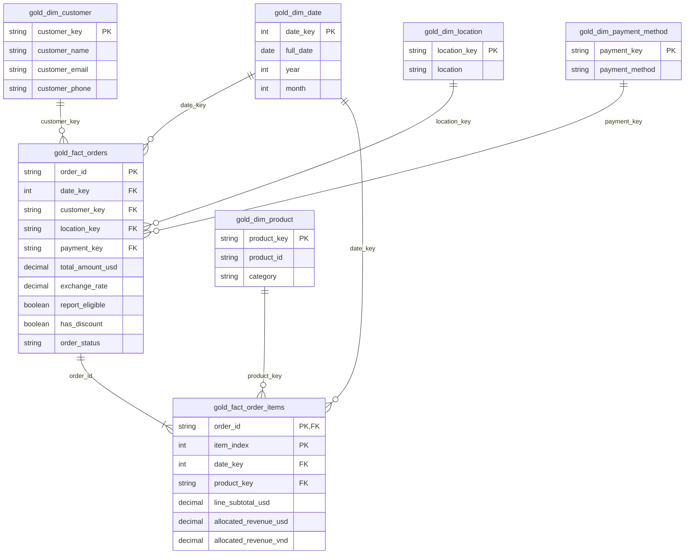

# ERD Gold

Khóa hash dùng SHA-256 trên JSON struct để tránh ghép chuỗi mơ hồ. Date key yyyyMMdd. Các fact chứa FK vào dimension; fact_order_items dùng (order_id,item_index) làm khóa. item_index là vị trí trong mảng nguồn, giữ được hai dòng sản phẩm giống nhau trong một đơn.

Dimension ngày phủ liên tục 2024-01-01 đến 2025-12-31. Tỷ giá đã join vào fact_orders theo năm/tháng/currency; không join bảng tỷ giá lần nữa trong BI. Customer age và feedback nằm tại fact_orders vì là thuộc tính ghi nhận tại giao dịch.

Đây là nguồn sơ đồ để xuất ảnh, chưa phải ảnh chụp ERD từ Fabric. Không dùng dữ liệu khách hàng trong ảnh trình bày công khai.
