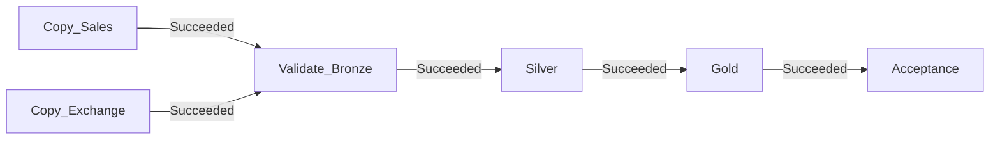

# Tài liệu hiểu và bảo vệ project — Bùi Quang Khánh

Tài liệu đối chiếu trực tiếp bốn notebook trong `fabric/prepared`, cấu hình pipeline và JSON nghiệm thu Fabric. Giải thích này không thay đổi code hoặc tự thêm tính năng chưa triển khai.

## 1. Bài giới thiệu trong khoảng một phút

“Em xây pipeline bán lẻ MINDX-Mart trên Microsoft Fabric theo kiến trúc Medallion. Hai Copy Activity lấy sales và tỷ giá từ CSV, ghi Parquet nguyên trạng ở Bronze. Notebook kiểm tra Bronze đối chiếu cả schema và nội dung với nguồn. Silver dùng PySpark để loại trùng, parse JSON, chuẩn hóa và cách ly lỗi; ghi Delta Tables. Gold tách fact đơn hàng và fact dòng sản phẩm, tạo dimension và báo cáo doanh thu VNĐ theo tháng/danh mục cùng tỷ lệ dùng mã theo địa điểm. Em phân bổ tổng tiền đơn cho từng dòng để tránh cộng lặp. Notebook Acceptance kiểm tra các bảng đã ghi và chỉ xuất PASS sau khi đối soát thành công. Run Fabric thực tế có cả sáu activity Succeeded.”

Các con số cần nhớ: 5.250 dòng nguồn; 250 dòng trùng; 104 đơn cách ly; 4.896 đơn Silver; 9.850 dòng sản phẩm; 24 tỷ giá; 2.669 đơn báo cáo; 885 Completed; 15 bảng.

## 2. Phân biệt các khái niệm

| Khái niệm | Vai trò trong bài |
|---|---|
| Microsoft Fabric | Nền tảng chứa workspace, Lakehouse, pipeline và notebook |
| Workspace | Không gian quản lý các tài nguyên của project |
| Capacity | Tài nguyên tính toán được chia sẻ; có hạn mức |
| OneLake | Tầng lưu trữ dữ liệu của Fabric |
| Lakehouse | Nơi tổ chức Files và Tables; bài dùng lh_mindx_final |
| Files | Khu vực file: CSV nguồn, Parquet Bronze, CSV báo cáo |
| Tables | Khu vực bảng Delta được Spark truy vấn bằng tên |
| Pipeline | Điều phối hoạt động, dependency, tham số và theo dõi run |
| Activity | Một bước của pipeline: Copy hoặc Notebook |
| Notebook | Mã PySpark chạy bằng Spark để đọc, biến đổi, kiểm tra và ghi |
| PySpark | API Python cho Apache Spark; notebook không phải pandas |
| Parquet | Định dạng cột, phù hợp quét dữ liệu phân tích và nén |
| Delta Table | Dữ liệu Parquet cùng transaction log; thêm quản lý phiên bản/transaction cho bảng |
| Schema dbo | Namespace của các bảng, ví dụ dbo.silver_sales; khác schema kiểu dữ liệu của DataFrame |

Pipeline điều phối; notebook thực hiện xử lý. Chọn Notebook Activity không tự viết logic làm sạch. Định dạng file khác nền tảng: Fabric vẫn cần Spark, Parquet và Delta để xử lý/lưu dữ liệu.

Delta đảm bảo transaction trong phạm vi bảng; không có transaction chung cho 15 bảng trong code. Ghi Gold dở rồi lỗi có thể để lại các bảng thuộc các thời điểm khác nhau. Vì vậy, chỉ dùng kết quả sau Acceptance PASS, không chạy hai batch cùng lúc.

## 3. Sơ đồ thực tế và dependency



Hai Copy độc lập có thể chạy song song. Validate_Bronze cần cả hai thành công; nếu một Copy fail thì không xử lý dữ liệu thiếu. Các notebook sau chạy tuần tự vì phụ thuộc dữ liệu đã ghi.

Không nhầm nút Validate pipeline với Validate_Bronze: nút Validate kiểm tra cấu hình pipeline; notebook Validate_Bronze đọc và kiểm tra dữ liệu thật.

## 4. Tham số và đường dẫn

| Tham số | Ý nghĩa |
|---|---|
| run_id | Nhận @pipeline().RunId; xác định snapshot của batch |
| source_folder=Source | Đọc CSV trong Files/Source |
| bronze_folder=Bronze | Đọc Parquet của đúng batch trong Files/Bronze/<run_id>/ |
| reports_folder=Reports | Xuất báo cáo/marker theo batch |
| table_schema=dbo | Định danh bảng dbo.<table> |
| strict_project_snapshot=true | Bật thêm kiểm tra số liệu chuẩn của bộ CSV đã cung cấp |

Cell được gắn tag parameters chứa giá trị mặc định. Pipeline truyền Base parameters để ghi đè mặc định tại thời điểm chạy. `run_id='manual'` là mặc định khi mở notebook, không tự tìm run gần nhất.

Ví dụ run thành công:

```text
Files/Source/mindx_raw_sales_data.csv
Files/Source/exchange_rate_2425.csv
Files/Bronze/46d7ce91-000d-4f37-a118-719fa2b51b3c/sales/
Files/Bronze/46d7ce91-000d-4f37-a118-719fa2b51b3c/exchange_rate/
Files/Reports/46d7ce91-000d-4f37-a118-719fa2b51b3c/
Tables: dbo.silver_sales, dbo.gold_fact_orders, ...
```

Trong giao diện Copy đã chọn root Files, Directory không thêm Files/ lần nữa. Trong Spark notebook, relative path có tiền tố Files/. Hai cách biểu diễn này trỏ cùng khu vực lưu trữ.

`config.json` là cấu hình trên máy, không phải file mà notebook đang chạy trên Fabric tự đọc. Sửa config chỉ có hiệu lực lên file cục bộ khi chạy configure.py --write; muốn thay trên Fabric cần cập nhật notebook và Base parameters. Hai Copy cũng phải đổi folder nếu thay tham số tương ứng.

Tắt strict_project_snapshot không làm bài thành pipeline tổng quát cho mọi dữ liệu: code vẫn có kiểm tra 24 tỷ giá, năm 2024–2025 và các quy tắc cố định khác.

## 5. Bước Copy_Sales và Copy_Exchange

Đầu vào sales có 15 cột; customer_info và items vẫn là chuỗi JSON bên trong CSV. Tỷ giá có năm, tháng, tiền nguồn/đích và exchange_rate.

CSV dùng dấu phẩy phân cách, nhưng JSON cũng có dấu phẩy. Vì vậy cần quote/escape đúng là dấu nháy kép để JSON không bị tách thành nhiều cột. First row as header giúp đọc tên cột thay vì coi header là giao dịch.

Cả nguồn và đích đều map String. Nếu infer kiểu số quá sớm, tuổi “twenty” hoặc số tiền “$925.24” có thể bị lỗi hoặc thành null trước khi Silver được kiểm tra. Bronze phải bảo toàn dữ liệu lỗi có chủ ý, không chữa lỗi.

Đích là Parquet, nén Snappy. Đổi từ CSV sang Parquet là đổi định dạng vật lý; yêu cầu giữ nguyên giá trị/cột không có nghĩa file hai bên phải giống nhau từng byte. Kích thước file đọc/ghi khác nhau do nén là bình thường.

Mỗi run có thư mục Bronze riêng để không đọc gộp các batch. Đây là phân tách snapshot theo thư mục, không phải thuật toán incremental hay partition bảng Delta theo tháng.

## 6. Notebook 01_bronze_validation

Các bước:

1. Nhận tham số, thiết lập timezone Spark và helper tạo đường dẫn/tên bảng.
2. Đọc Parquet sales và exchange_rate của đúng run_id.
3. Kiểm tra đúng tập 15/5 tên cột và toàn bộ kiểu String.
4. Với snapshot hiện tại, kiểm tra sales 5.250 dòng; tỷ giá 24 dòng. Kiểm tra các giá trị đặc trưng như tiền có $ và tuổi twenty còn tồn tại.
5. Đọc lại CSV gốc bằng Spark với inferSchema=false, quote/escape đúng, mode FAILFAST.
6. Chọn cùng thứ tự cột rồi đối chiếu số dòng và exceptAll hai chiều.

`exceptAll` giữ ý nghĩa số lần xuất hiện. Nếu nguồn có một dòng hai lần mà Bronze chỉ còn một lần, phép so sánh vẫn phát hiện. Chỉ so distinct hoặc chỉ so tổng số dòng đều chưa đủ: tổng dòng có thể bằng nhau nhưng giá trị bị thay.

Notebook 01 không tạo bảng Silver/Gold. Nó là cổng kiểm tra trước xử lý. Nếu fail ở đây, kiểm tra Copy mapping/CSV/đường dẫn trước, không tắt assert chỉ để làm pipeline xanh.

## 7. Notebook 02_silver — sales

### 7.1 Loại trùng và phát hiện xung đột

`raw.dropDuplicates()` loại các dòng trùng hoàn toàn. Còn 5.000 bản ghi duy nhất từ 5.250 dòng. Sau đó groupBy(order_id).count() để phát hiện cùng mã đơn còn nhiều nội dung khác nhau. Những trường hợp xung đột bị gắn cờ và cách ly.

Không dùng dropDuplicates(['order_id']) ngay: cách đó có thể tùy ý giữ một phiên bản khi các phiên bản khác nội dung.

`raw_record` được tạo bằng to_json(struct(...)) để giữ nội dung đã đọc phục vụ truy vết. Đây là JSON biểu diễn lại các trường, không phải bản sao byte chính xác của dòng CSV. Bronze và CSV nguồn mới là dữ liệu gốc để truy lại.

### 7.2 Parse và chuẩn hóa

| Trường | Cách xử lý |
|---|---|
| order_date | thử ISO timestamp, rồi dd/MM/yyyy HH:mm; tạo timestamp và ngày |
| customer_info | from_json thành struct name/email/phone |
| items | from_json thành array struct product_id/category/price/quantity |
| customer_age | twenty→20, thirty-five→35, try_cast int; ngoài 18–100 để null |
| total_amount | bỏ $ ở đầu rồi try_cast Decimal(18,2) |
| shipping_cost | try_cast Decimal(18,2), số âm là lỗi |
| payment_method | bỏ space/underscore, lowercase để nhận diện creditcard; chuẩn hóa Credit Card |
| device_type | thiếu/rỗng → Unknown |
| location | thiếu/rỗng → Unknown |
| feedback_score | try_cast decimal; giữ giá trị lỗi nhưng không cho vào báo cáo |
| loyalty_points | try_cast bigint |
| discount_code | trim khoảng trắng |

`try_cast`/`try_to_timestamp` trả null khi không chuyển được thay vì làm cả job chết vì một giá trị lỗi. Nhưng null sau chuyển đổi còn phải được kiểm tra; try_cast không đồng nghĩa dữ liệu đã hợp lệ.

Nguồn ngày không có timezone. Đặt session timezone UTC giúp cách parse nhất quán, không chứng minh timestamp nguồn là thời điểm UTC thực tế. Nếu dùng dữ liệu thật phải xác nhận timezone nguồn.

### 7.3 Quarantine và tập báo cáo là hai khái niệm khác nhau

Cách ly đơn có mã đơn/ngày/customer JSON/items/tổng tiền/phí vận chuyển/currency/status/payment không hợp lệ hoặc order_id xung đột. Với items, dùng exists để kiểm tra có bất kỳ phần tử nào thiếu mã/danh mục, giá không dương hay quantity không dương. Một dòng items lỗi làm cả đơn bị cách ly để không tạo báo cáo thiếu một phần đơn.

Quarantine có order_id, error_reason và raw_record. Một đơn có thể có nhiều nguyên nhân, nối bằng dấu chấm phẩy. Trên dữ liệu này có 104 đơn cách ly do shipping âm.

Thiếu tuổi/email không làm đơn mất khả năng tính doanh thu nên được giữ null. Failed là trạng thái kinh doanh hợp lệ để kiểm toán, không phải lỗi parse; feedback 99/null cũng được giữ Silver nhưng gắn cờ không đủ điều kiện báo cáo.

```text
report_eligible = (order_status != 'Failed') AND (feedback_score BETWEEN 1 AND 5)
```

Nếu biểu thức thành null do thiếu feedback, coalesce(...,False) gán false. BETWEEN bao gồm hai biên 1 và 5; code đang kiểm tra khoảng giá trị, không định nghĩa enum chỉ gồm các số nguyên.

### 7.4 Tách order và items

`posexplode(parsed_items)` tạo một dòng cho mỗi sản phẩm và giữ item_index bắt đầu từ 0. Khóa (order_id,item_index) giữ được hai dòng giống hệt sản phẩm trong cùng đơn. Nếu chỉ dùng (order_id,product_id), có thể mất dòng hợp lệ.

Đầu ra sạch: silver_sales 4.896 dòng và silver_sales_items 9.850 dòng. Đơn không đủ điều kiện báo cáo vẫn có thể có items trong Silver; chưa lọc Failed/feedback ở đây.

Đối soát:

```text
5.250 = 250 dòng trùng loại bỏ + 104 đơn cách ly + 4.896 đơn sạch
4.896 = 2.669 đơn đủ điều kiện báo cáo + 2.227 đơn còn lại
```

Không cộng số Failed và feedback lỗi để tính 2.227 nếu chưa loại phần giao nhau: một đơn có thể đồng thời Failed và feedback 99.

## 8. Notebook 02_silver — tỷ giá

Loại trùng hoàn toàn; chuẩn hóa năm/tháng sang int, mã tiền sang uppercase, tỷ giá sang Decimal(18,6). Kiểm tra khóa (year,month,from_currency,to_currency), năm 2024–2025, tháng 1–12, cặp USD→VND và tỷ giá >0. Khóa xung đột bị cách ly.

Đầu ra silver_exchange_rate có 24 dòng và silver_exchange_rate_quarantine có 0 dòng. Bảng cách ly rỗng là một kết quả hợp lệ, không phải thiếu bảng.

## 9. Toàn bộ 15 bảng: grain, khóa và ý nghĩa

Grain là ý nghĩa của một dòng. Trước khi join hoặc tính chỉ số phải nói được grain của mỗi bảng.

| Bảng | Số dòng | Grain / khóa logic / vai trò |
|---|---:|---|
| silver_sales | 4.896 | Một đơn hợp lệ sau làm sạch; order_id |
| silver_sales_items | 9.850 | Một dòng items của đơn sạch; (order_id,item_index) |
| silver_sales_quarantine | 104 | Một bản ghi đơn bị cách ly; order_id để truy vết, không mặc định duy nhất nếu có xung đột |
| silver_exchange_rate | 24 | Một tỷ giá theo tháng và cặp tiền; (year,month,from_currency,to_currency) |
| silver_exchange_rate_quarantine | 0 | Một bản ghi tỷ giá lỗi; raw_record/error_reason |
| gold_dim_date | 731 | Một ngày; date_key kiểu int yyyyMMdd |
| gold_dim_customer | 4.896 | Một hồ sơ (name,email,phone) phân biệt; customer_key |
| gold_dim_location | 4.157 | Một địa điểm; location_key |
| gold_dim_payment_method | 3 | Một phương thức: Credit Card, PayPal, COD; payment_key |
| gold_dim_product | 4.025 | Một cặp (product_id,category); product_key |
| gold_fact_orders | 4.896 | Một đơn; order_id; FK date/customer/location/payment |
| gold_fact_order_items | 9.850 | Một dòng sản phẩm; (order_id,item_index); FK order/date/product |
| gold_monthly_revenue_category | 120 | Một (year,month,category) của tập báo cáo theo đề |
| gold_monthly_completed_revenue_category | 120 | Một (year,month,category) của tập chỉ Completed |
| gold_promotion_by_location | 2.425 | Một location có đơn đủ điều kiện; total_orders/orders_with_discount/discount_order_pct |

5 bảng Silver + 5 dimension + 2 fact + 3 aggregate = 15.

`gold_dim_customer` là 4.896 hồ sơ theo khóa nguồn, không đủ cơ sở gọi là 4.896 người mua thực tế. Mô hình không có customer_id nghiệp vụ để hợp nhất một người thay email/điện thoại.

4.025 sản phẩm ở đây là 4.025 cặp mã/danh mục, không nhất thiết 4.025 mã sản phẩm duy nhất. Dữ liệu không đảm bảo product_id→category, nên dim_product chỉ khóa theo product_id sẽ sai.

731 ngày vì 2024 nhuận (366 ngày), 2025 có 365 ngày. 120 nhóm doanh thu tương ứng 24 tháng × 5 danh mục trong dữ liệu hiện tại; không có nghĩa cả hệ thống chỉ có 120 giao dịch.

Fact lưu sự kiện và số đo; dimension lưu thuộc tính mô tả để lọc/nhóm. Bài có hai nhánh fact dùng dimension, có thể mô tả là mô hình dimensional nhiều fact/fact constellation phát triển từ star schema. Không gọi là một star đơn với một fact. Quan hệ order→items còn phục vụ truy vết và lấy thuộc tính đơn; khi dựng semantic model BI cần thiết kế đường filter rõ để tránh quan hệ mơ hồ.

## 10. Notebook 03_gold

### 10.1 Join tỷ giá và tạo khóa

Đọc Silver, lấy year/month từ ngày đơn rồi left join tỷ giá theo year/month/currency. Silver đã kiểm tra cặp USD→VND, nên Gold có thể chọn từ_currency thành currency và không cần join thêm to_currency. Kiểm tra tỷ giá không trùng khóa trước join, và không có exchange_rate null sau join.

Left join giúp giữ đơn để phát hiện thiếu tỷ giá; inner join có thể âm thầm bỏ đơn thiếu tỷ giá. Bảng tỷ giá không duy nhất có thể làm một đơn nhân thành nhiều dòng, nên cần kiểm tra uniqueness trước join.

Khóa dimension là SHA-256 của to_json(struct(các trường)). Struct JSON giúp tránh ghép chuỗi mơ hồ. SHA-256 là khóa kỹ thuật xác định theo giá trị, không phải thuật toán xác minh danh tính; hash cũng không biến toàn bộ bảng khách hàng thành dữ liệu vô danh vì tên/email/phone vẫn nằm trong dimension.

### 10.2 Vì sao tách hai fact?

Một đơn có thể có nhiều sản phẩm. Cộng total_amount sau khi join order→items sẽ cộng lặp. Fact_orders dùng để đếm đơn và tính khuyến mãi; fact_order_items dùng để phân tích danh mục và số lượng/tiền dòng.

Đầu ra fact_orders vẫn gồm cả các đơn không đủ điều kiện báo cáo, kèm report_eligible. Ba aggregate Gold mới dùng tập đã lọc. Vì vậy, thấy Failed trong gold_fact_orders không có nghĩa báo cáo cuối sai.

### 10.3 Phân bổ doanh thu

```text
line_subtotal = price × quantity
order_subtotal = tổng line_subtotal trong một đơn
rounded_allocation = round(total_amount × line_subtotal / order_subtotal, 2)
residual = total_amount − tổng rounded_allocation
allocated_revenue_usd = rounded_allocation + residual ở dòng item_index lớn nhất
allocated_revenue_vnd = allocated_revenue_usd × tỷ giá tháng
```

Window.partitionBy(order_id) cho phép tính tổng theo đơn nhưng vẫn giữ từng dòng items. Đối soát tổng phân bổ USD bằng total_amount của từng đơn là chính xác sau gán residual, không chỉ “gần bằng”. Cột USD được lưu decimal; tiền VND phân bổ lưu Decimal(30,6), tổng có thể có nhiều chữ số phần thập phân.

Ví dụ thật từ nguồn: TXN-103535 ngày 31/08/2025, Completed, feedback 3:

| Dòng | Giá × lượng | Tiền hàng USD | Tiền đơn phân bổ USD | VNĐ, rate=25.440 |
|---|---|---:|---:|---:|
| PRD-740 / Clothing | 50,31 × 3 | 150,93 | 153,55 | 3.906.312,00 |
| PRD-719 / Home & Kitchen | 379,27 × 2 | 758,54 | 771,69 | 19.631.793,60 |
| Tổng | | 909,47 | 925,24 | 23.538.105,60 |

total_amount là 925,24, shipping_cost là 9,23; tổng tiền hàng + shipping là 918,70, không khớp total_amount. Không tự sửa dữ liệu thành đẳng thức không có trong nguồn. Quy tắc bài chọn phân bổ total_amount; không cộng shipping thêm lần nữa. Chênh lệch không được tự gọi là thuế hoặc số tiền giảm giá vì nguồn không mô tả như vậy.

### 10.4 Hai tập doanh thu

Tập theo đề: report_eligible=true, gồm cả Pending/Refunded nếu thỏa điều kiện còn lại. Tổng 68.128.580.695,61 VNĐ.

Tập bổ sung chỉ Completed: report_eligible=true AND order_status='Completed'. Tổng 22.440.017.306,84 VNĐ; 885 đơn. Đây không phải toàn bộ Completed trong nguồn, mà là Completed sau làm sạch và lọc feedback.

Không gọi số Completed là lợi nhuận hoặc net cash: không có cost, dữ liệu thanh toán thực nhận hay số tiền hoàn trả. Nếu yêu cầu nghiệp vụ chính thức xác định doanh thu phải loại Pending/Refunded thì dùng/chỉnh định nghĩa Completed và mô tả rõ, không âm thầm đổi tập báo cáo.

### 10.5 Khuyến mãi

`has_discount` là discount_code sau trim không rỗng, null quy về false. Nhóm fact_orders đã lọc theo location:

```text
discount_order_pct = orders_with_discount / total_orders × 100
```

Ví dụ minh họa: địa điểm có 10 đơn hợp lệ, 3 đơn dùng mã → 30%. Không phải lấy tỷ trọng đơn dùng mã của địa điểm đó trên tổng tất cả đơn dùng mã toàn công ty. Không đếm trên items: một đơn dùng mã có ba dòng vẫn chỉ là một đơn dùng mã.

silver/gold_dim_location có 4.157 địa điểm, nhưng aggregate chỉ có 2.425 vì chỉ chứa địa điểm có đơn đủ điều kiện. Không coi sự khác biệt này là mất dữ liệu do join.

## 11. Notebook 04_acceptance

Đọc lại 15 Delta Tables đã ghi; không chỉ kiểm tra DataFrame còn ở biến của Gold. Kiểm tra số dòng order/item giữa Silver và Gold; uniqueness order và khóa ghép item; quan hệ khóa với dimension/order; lọc Failed/feedback; tổng tiền phân bổ theo đơn; tổng doanh thu quy đổi; tổng đơn/đơn dùng mã của báo cáo khuyến mãi.

Khi strict=true, đối chiếu thêm số dòng và hai tổng tiền chuẩn. Tính đúng với mốc này chứng minh kết quả cho bộ dữ liệu cố định, không chứng minh mọi dữ liệu tương lai đều đúng hoặc quy tắc nghiệp vụ là lựa chọn duy nhất.

Sau khi kiểm tra, xuất ba CSV theo folder và ghi marker acceptance cuối cùng. Spark ghi một thư mục có part-file và có thể có _SUCCESS; không kỳ vọng file tên cố định report.csv. `coalesce(1)` tạo một part-file dễ tải cho dữ liệu nhỏ, không nên áp dụng máy móc cho xuất hàng tỷ dòng. _SUCCESS là marker của thao tác ghi Spark, khác JSON nghiệp vụ có status=PASS.

## 12. Đọc JSON nghiệm thu

| Trường | Diễn giải |
|---|---|
| status=PASS | Các assert của Acceptance và các lệnh ghi trước marker đã hoàn thành |
| run_id | ID pipeline batch, dùng nối đường dẫn Bronze/Reports |
| engine | Nhãn engine do code ghi: Fabric PySpark |
| spark_version | Phiên bản Spark runtime thực tế; run này 4.1.1.5.5.20260929.238183312 |
| finished_utc | Thời điểm UTC khi tạo summary; 05:14:12 UTC tương ứng 12:14:12 Việt Nam ngày 06/11/2026 |
| table_counts | Số dòng của từng bảng, không phải tổng file/byte |
| eligible_orders=2669 | Đơn đủ điều kiện của tập báo cáo |
| completed_orders=885 | Completed trong tập đủ điều kiện |
| revenue_vnd | Tổng theo điều kiện đề |
| completed_revenue_vnd | Tổng theo tập Completed bổ sung |

Số tiền được JSON hóa thành chuỗi để giữ độ chính xác Decimal; đuôi .610000 là cách biểu diễn scale, không phải sai khác số tiền.

PASS không chứng minh có Power BI dashboard, lịch chạy, incremental load, xử lý dữ liệu thời gian thực hoặc transaction đa bảng. Những tính năng đó không nằm trong project hiện tại.

## 13. Đọc log trên Fabric: từ ngoài vào trong

1. Pipeline run: chọn đúng Run ID và thời điểm, xem Pipeline status. Không trộn một run fail cũ với run mới success.
2. Activity run: xem sáu activity, status, start time, duration, Input, Output/Error. Input là cấu hình/giá trị truyền vào; không phải toàn bộ dữ liệu nguồn. Xem run_id và các Base parameters nếu nghi lệch đường dẫn.
3. Copy Output: tùy connector có rowsRead/rowsCopied, dataRead/dataWritten, filesRead/filesWritten, copyDuration, throughput, errors và queue/integration runtime. Không mặc định mọi field đều tồn tại. dataRead/dataWritten là dung lượng, không phải số giao dịch. Số file và byte không thay thế đối soát số dòng.
4. Notebook run: mở run detail/log, tìm cell fail, exception và thông báo assert, driver/Spark application logs nếu cần. Notebook activity Output có thể chỉ chứa liên kết/trạng thái chạy; không phải mọi display()/print() đều nằm ngay trong popup Output.
5. Dữ liệu đã ghi: mở Tables và Reports của đúng run. Job xanh chưa đủ nếu không xác minh chỉ số; vì vậy có Acceptance.

Duration có thể gồm thời gian chờ cấp tài nguyên, tạo Spark session, đọc/ghi và xử lý. Không kết luận thuật toán Gold chậm chỉ từ duration; cần xem session startup và Spark stages. WARN không tự đồng nghĩa fail; tìm exception/status thật. Một DataFrame biến đổi có thể chưa thực thi cho tới action như count/show/write vì Spark đánh giá lazy.

### Lỗi thực tế đã gặp

Thông báo có “Notebook service http 200” nhưng bên trong “Failed to create Livy session”, TooManyRequestsForCapacity, HTTP 430. Đây là dịch vụ phản hồi yêu cầu, nhưng phiên tính toán không tạo được; Gold chưa chạy code xử lý. Không sửa công thức doanh thu để chữa lỗi tài nguyên.

Đã kiểm tra High concurrency cho pipeline, dùng cùng session tag mindx_final, cùng Lakehouse/runtime và không mở nhiều phiên thử không cần thiết. Run sau đó thành công. Không kết luận chỉ một thay đổi chắc chắn là nguyên nhân duy nhất vì mức tải capacity dùng chung cũng có thể thay đổi.

Job history có Succeeded không có nghĩa đã quan sát được toàn bộ capacity hoặc mọi session đã được giải phóng. Xem Job management/Monitoring cho chạy/chờ; chỉ dừng job của mình không còn cần. Không hủy job người khác trong capacity trường học.

### Các lỗi khác và nơi cần xem

| Dấu hiệu | Kiểm tra trước |
|---|---|
| PATH_NOT_FOUND tại Bronze | run_id có phải dynamic expression, Copy folder có đúng và cùng run không |
| File JSON vỡ thành nhiều cột | delimiter/quote/escape/header của CSV Source |
| “Copy mapping must preserve source as strings” | mapping/Parquet schema có cột bị infer số không |
| “Bronze changed source values” | so CSV/Parquet, null/rỗng, kiểu dữ liệu, source có bị thay giữa batch không |
| TABLE_OR_VIEW_NOT_FOUND | notebook trước đã ghi chưa; default Lakehouse/schema có đúng không |
| Missing exchange rate | tháng/ngày/currency có parse đúng, tỷ giá thiếu hoặc bị quarantine không |
| Revenue mismatch | join có nhân dòng, grain có đúng, phân bổ/Decimal/tỷ giá có đúng không |
| AssertionError số lượng chuẩn | có dùng đúng CSV gốc, đã loại trùng/lọc đúng, strict=true có phù hợp không |
| 401/403 | connection, tài khoản chạy, quyền workspace/Lakehouse, phiên xác thực |
| HTTP 430 / TooManyRequestsForCapacity | tài nguyên Spark, session, job đang chạy/chờ |

Run ID notebook/Livy/Spark application không nhất thiết bằng Pipeline Run ID. Đường dẫn của bài lấy ID được truyền từ pipeline, không lấy một ID bất kỳ trong exception.

## 14. SQL đọc bảng để demo

Các ví dụ chạy trong cell Spark SQL của notebook Fabric đã gắn đúng Lakehouse. Đây là truy vấn chỉ đọc, không sửa dữ liệu.

```sql
%%sql
SELECT order_id, order_status, feedback_score, total_amount_usd, report_eligible
FROM dbo.silver_sales
LIMIT 10;
```

```sql
%%sql
SELECT error_reason, COUNT(*) AS records
FROM dbo.silver_sales_quarantine
GROUP BY error_reason;
```

```sql
%%sql
SELECT report_eligible, order_status, COUNT(*) AS orders
FROM dbo.gold_fact_orders
GROUP BY report_eligible, order_status
ORDER BY report_eligible, order_status;
```

```sql
%%sql
SELECT year, month, category, total_revenue_vnd
FROM dbo.gold_monthly_revenue_category
ORDER BY year, month, category;
```

```sql
%%sql
SELECT location, total_orders, orders_with_discount, discount_order_pct
FROM dbo.gold_promotion_by_location
ORDER BY total_orders DESC, location
LIMIT 20;
```

```sql
%%sql
SELECT SUM(total_revenue_vnd) AS total_vnd
FROM dbo.gold_monthly_revenue_category;
```

```sql
%%sql
SELECT i.order_id, SUM(i.allocated_revenue_usd) AS allocated,
       MAX(o.total_amount_usd) AS source_order_total
FROM dbo.gold_fact_order_items i
JOIN dbo.gold_fact_orders o ON i.order_id=o.order_id
GROUP BY i.order_id
HAVING SUM(i.allocated_revenue_usd) <> MAX(o.total_amount_usd);
```

Truy vấn cuối phải không có dòng. Dùng MAX cho tổng đơn vì cùng một giá trị lặp sau join; không SUM total_amount_usd ở phía order sau join một-nhiều.

## 15. Câu hỏi bảo vệ thường gặp

**Vì sao chọn Fabric?** Đề yêu cầu; nền tảng tích hợp orchestration, Lakehouse và Spark notebook. Không nói Fabric cần thiết vì 5.250 dòng quá lớn cho máy cá nhân.

**Vì sao PySpark khi dữ liệu nhỏ?** Để đáp ứng yêu cầu và thực hành pipeline phân tán/schema/Delta. pandas cũng xử lý được dung lượng này nhưng không thay yêu cầu kỹ thuật của đề.

**Bronze có làm sạch không?** Không. Chỉ đổi định dạng, bảo toàn cột/giá trị và dòng trùng để Silver kiểm tra có chủ đích.

**Vì sao dùng String ở Bronze?** Tránh mất giá trị hỗn hợp trước làm sạch. Kiểu nghiệp vụ được tạo ở Silver.

**Duplicate khác quarantine ra sao?** Dòng trùng hoàn toàn được loại; quarantine lưu bản ghi không đạt quy tắc. 250 dòng trùng không nằm trong 104 đơn cách ly.

**Tại sao không đổi shipping âm thành 0?** Không có bằng chứng giá trị đúng là 0; cách ly giữ khả năng giải thích và tránh tự sửa tiền tùy ý. Nếu nghiệp vụ xác nhận âm là hoàn phí thì phải đổi chính sách.

**Tại sao giữ Failed trong Silver/fact?** Để kiểm toán và phân tích trạng thái; chỉ các chỉ số cuối dùng report_eligible.

**Tại sao không điền tuổi trung bình?** Tuổi không cần cho chỉ số hiện tại; điền trung bình tạo thông tin suy đoán và ảnh hưởng phân tích khách hàng.

**Feedback null có hợp lệ không?** Không được chứng minh nằm trong 1–5 nên bài loại khỏi tập báo cáo. Đây là lựa chọn được ghi rõ; không suy ra yêu cầu mọi doanh nghiệp đều phải làm như vậy.

**Tại sao doanh thu dùng total_amount?** Chọn tổng tiền đơn làm nguồn kiểm soát và phân bổ xuống dòng. Có thể dùng doanh thu sản phẩm price×quantity nếu định nghĩa khác, nhưng phải giải thích và đối soát theo định nghĩa đó.

**Mã giảm giá làm giảm bao nhiêu tiền?** Không biết. Code chỉ biết có/không dùng mã, không tự suy diễn mức giảm từ ký tự mã.

**Tại sao 15 bảng mà chỉ hai nguồn?** Một nguồn được tách ra các grain, dimension, fact, quarantine và aggregate phục vụ nhiều mục tiêu. Số bảng không phải số nguồn.

**Khóa ngoại có tự bị engine từ chối khi sai không?** Project kiểm tra bằng assert và left_anti join. Không tuyên bố đã khai báo hoặc cưỡng chế PK/FK vật lý cho Lakehouse.

**Có phải star hay snowflake?** Đây là thiết kế dimensional có hai fact và dimension. Fact_orders là nhánh sao; fact_items phục vụ grain sản phẩm, dùng chung date và nối order để truy vết. Nếu cần semantic model BI thuần hai sao, có thể bổ sung các FK dimension cần thiết vào fact_items và quản lý đường lọc; phần đó chưa triển khai.

**Chạy lại có bị nhân đôi không?** Bronze thêm snapshot mới theo run_id; Silver/Gold overwrite nên không append lặp. Không phải toàn bộ filesystem giữ nguyên: Bronze/Reports vẫn có thêm folder run mới, Delta có thể giữ lịch sử theo retention.

**Đã chứng minh chạy lại trên Fabric chưa?** Có bằng chứng một run Fabric thành công. Các kiểm thử hai lần cục bộ đã qua; chưa có bằng chứng run Fabric thứ hai thành công trong bộ đã lưu. Không nhận là đã chứng minh nếu chưa thực hiện.

**Có incremental/MERGE/SCD không?** Chưa. Hiện full snapshot overwrite. Muốn mở rộng cần khóa nghiệp vụ, watermark, xử lý late data/update/delete và chiến lược merge/SCD rõ.

**Có kiểm tra mọi dữ liệu bất thường chưa?** Có các quy tắc đã mã hóa, không có cam kết bao phủ mọi trường hợp. Ví dụ nhận diện khách hàng, kiểm tra email/phone sâu, nguồn timezone, xử lý đổi danh mục theo lịch sử đều chưa đầy đủ.

**Cần cải tiến gì cho production?** Bổ sung audit theo run cho các bảng, staging/publish để hạn chế snapshot trộn giữa bảng, logging có cấu trúc, kiểm tra dữ liệu đa dạng hơn, incremental có thiết kế, bảo vệ PII và semantic model BI. Không nói những phần này đã có.

## 16. Trình tự demo khoảng 5–7 phút

1. Nêu mục tiêu/nguồn và sơ đồ sáu activity.
2. Cho xem Source/CSV và Bronze của đúng run, giải thích giữ String và giữ trùng.
3. Mở Silver notebook, chỉ nhóm parse JSON/date, error_reason, report_eligible và posexplode.
4. Cho xem quarantine 104 dòng và hai bảng order/item, nói grain.
5. Mở ERD, giải thích hai fact, khóa product/customer và tỷ giá tháng.
6. Chỉ đoạn phân bổ tiền cùng Window/residual; dùng ví dụ TXN-103535 nếu cần.
7. Cho xem ba bảng Gold; phân biệt tập theo đề với Completed và tỷ lệ mã theo location.
8. Kết bằng pipeline Succeeded và acceptance PASS, nói một giới hạn và một hướng phát triển.

## 17. Tài liệu chính thức để tra cứu phần nền tảng

- Copy activity output và monitoring: https://learn.microsoft.com/en-us/fabric/data-factory/monitor-copy-activity
- Monitoring Spark: https://learn.microsoft.com/en-us/fabric/data-engineering/spark-monitoring-best-practices
- Session sharing trong pipeline: https://learn.microsoft.com/en-us/fabric/data-engineering/configure-high-concurrency-session-notebooks-in-pipelines
- Delta transaction/concurrency: https://learn.microsoft.com/en-us/fabric/data-engineering/delta-lake-concurrency-control
- Medallion và định dạng Delta/Parquet: https://learn.microsoft.com/en-us/fabric/onelake/onelake-medallion-lakehouse-architecture
